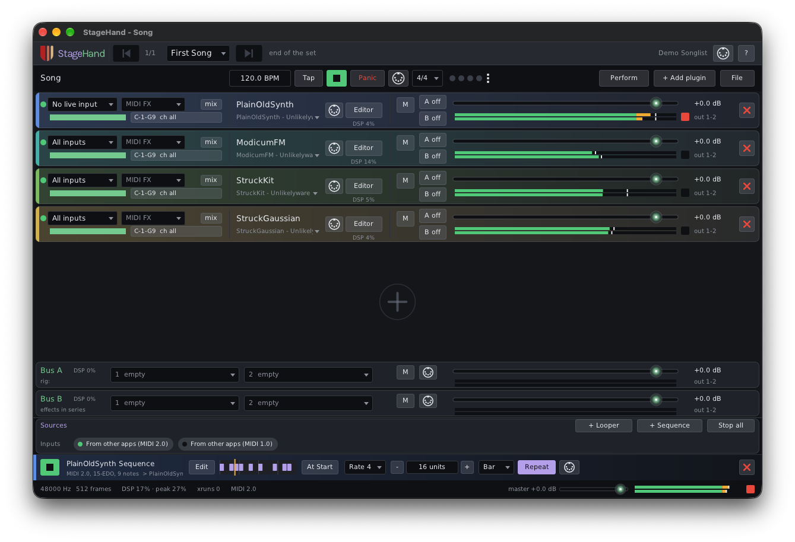

# StageHand

A live-performance host for CLAP plugins from Unlikelyware, with MIDI 1.0 and MIDI 2.0 both
first-class. It holds a set of instruments ready to play from your keyboards and controllers, moves
through the songs of a set without gaps, and keeps the band in time with a click, sequences and
loopers.



| | |
|---|---|
| Kind | App: hosts CLAP instruments, effects and note effects |
| Platforms | Linux x86-64, macOS 26 or later on Apple Silicon. No Windows. JACK (through PipeWire) on Linux, Core Audio on macOS |
| Version | 0.9.0 (preview) |
| License | MIT |

**Downloads:** ready-built apps will be on itch.io with the 0.9 preview. This repo has the
source only.

## What makes it different

- **MIDI 2.0 end to end.** A MIDI 2.0 keyboard reaches a MIDI 2.0 plugin with its full resolution
  and per-note expression, microtonal pitch included; MIDI 1.0 gear and plugins work as they always
  have, and StageHand translates where the two meet. CLAP note effects such as
  [Retune](https://github.com/erickampman/Retune) and [NoteGran](https://github.com/erickampman/NoteGran)
  sit in front of an instrument and keep the fraction.
- **Built for the stage.** Large, high-contrast controls on a dark window; faders that move only when
  dragged, so a stray click changes nothing; song switches that let the last song's reverb ring out;
  a Perform view with nothing on it to knock by accident; Panic.
- **A whole rig in one window.** Racks of plugins with their own inputs, filters and MIDI effects,
  effect buses shared by every song, sequences and loopers with count-in, and control links from
  hardware knobs to any plugin's parameters.
- **One file per gig.** A set is a `.setlist` package holding every song's rack and every plugin's
  settings, and StageHand reopens the last set where you left it.

The help page (Help in the app, or [resources/help/help.md](resources/help/help.md)) covers every
part of the window. The [command line](docs/command-line.md) (`stagehand --help`) plays a set, a
rack or one plugin, and lists plugins and MIDI sources.

## How it works

The design records: [architecture](docs/architecture.md), [domain model](docs/domain-model.md),
[rack format](docs/rack-format.md), [setlists](docs/setlists.md), [documents](docs/documents.md),
[rig](docs/rig.md), [MIDI effects](docs/midi-effects.md), [sequences](docs/sequences.md),
[looper](docs/looper.md), [controls](docs/controls.md) and the [macOS port](docs/macos.md).

## Installing

**macOS:** drag `StageHand.app` into Applications. The 0.9 previews aren't notarized, so the first
time macOS refuses to open it: open System Settings ▸ Privacy & Security and click Open Anyway. Or
clear the quarantine flag yourself:

```bash
xattr -dr com.apple.quarantine /Applications/StageHand.app
```

**Linux:** unpack the download anywhere you'll keep it, such as `~/.local/lib/stagehand`, and keep
`stagehand` and its `help` folder together (Help looks for `help/` beside the executable). To run
it as plain `stagehand`, link it into a directory on your `PATH`:

```bash
ln -sf ~/.local/lib/stagehand/stagehand ~/.local/bin/stagehand
```

Plugins go in the CLAP folder, where StageHand looks for them: `~/.clap` on Linux,
`~/Library/Audio/Plug-Ins/CLAP` on macOS.

## Building from source

```bash
git clone https://github.com/erickampman/StageHand.git
cd StageHand
tools/fetch_deps.sh
cmake -B build -G Ninja -DCMAKE_BUILD_TYPE=Release
cmake --build build
```

[BUILDING.md](BUILDING.md) has what to install first on Linux and macOS, the tests, and running it.

## Help and bugs

Questions and bug reports go to [GitHub Issues](https://github.com/erickampman/StageHand/issues).

## License

MIT. See [LICENSE](LICENSE) and [THIRD_PARTY_NOTICES.md](THIRD_PARTY_NOTICES.md).

## Trademarks

VST® is a registered trademark of Steinberg Media Technologies GmbH. Audio Units, Logic, Mac and
macOS are trademarks of Apple Inc., registered in the U.S. and other countries. Linux is the
registered trademark of Linus Torvalds in the U.S. and other countries. Other product names are
trademarks of their owners, named here only to say what works with what.
